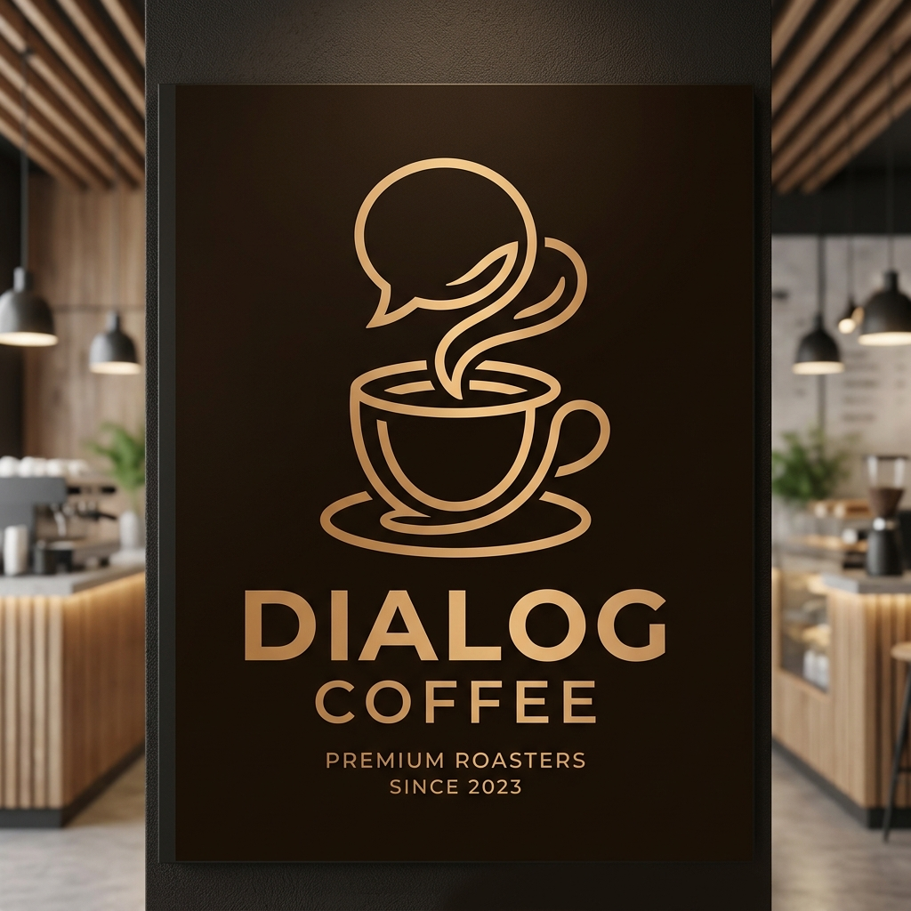

# ☕ DIALOG COFFEE Cashier (Android & Web)

Aplikasi Kasir & Pembukuan Keuangan Modern berbasis **Android** dan **Web** dengan desain monokrom **Hitam & Putih (Black & White Luxe Minimalist)** yang dirancang khusus untuk **DIALOG COFFEE**. Aplikasi ini mencatat pemasukan dan pengeluaran secara detil, terintegrasi notifikasi otomatis ke **WhatsApp Owner (085334101996)**, mendukung sistem **2 Shift (2 Barista per shift)**, bilingual (Indonesia & English), serta ekspor laporan ke format **Microsoft Word (.docx)** dan **Adobe PDF (.pdf)**.

<p align="center">
  
</p>

---

## 📋 Daftar Menu Resmi DIALOG COFFEE

### 1. 🍵 NON-COFFEE
| Menu | Harga | Keterangan |
| :--- | :--- | :--- |
| **BISCOFF** | Rp 22.000 | Lotus Biscoff blend creamy dengan biskuit karamel |
| **CARAMEL REGAL** | Rp 20.000 | Fresh milk, saus karamel lezat & biskuit Marie Regal |
| **COKLAT** | Rp 18.000 | Dark chocolate pekat dengan susu segar creamy |
| **THAITEA** | Rp 15.000 | Teh Thailand aromatik segar dan susu manis |
| **GREENTEA** | Rp 15.000 | Matcha green tea lembut menyegarkan |

### 2. ⭐ SIGNATURE DRINKS
| Menu | Harga | Keterangan |
| :--- | :--- | :--- |
| **DIALOG COFFEE** | Rp 20.000 | Signature house blend espresso, susu segar & gula aren spesial |
| **COFFEE SECRET** | Rp 20.000 | Racikan resep rahasia barista Dialog beraroma manis |
| **COFFEE MITOS** | Rp 20.000 | Sentuhan kopi mantap dengan aftertaste butterscotch |
| **AMERICANO** | Rp 18.000 | Double shot espresso arabica murni hangat / dingin |

### 3. ☕ COFFEE & FLAVOR
| Menu | Harga |
| :--- | :--- |
| **AMERICANO** | Rp 18.000 |
| **LEMSKUY** | Rp 18.000 |
| **CARAMEL MACHIATO** | Rp 18.000 |
| **VANILLA** | Rp 18.000 |
| **CARAMEL** | Rp 18.000 |
| **BUTTERSHCOOT** | Rp 18.000 |
| **TIRAMISU** | Rp 18.000 |
| **HAZELNUT** | Rp 18.000 |
| **PANDAN** | Rp 18.000 |

---

## ⚡ Fitur Utama & Pembaruan

### 1. 📲 Notifikasi WhatsApp Otomatis ke Owner (`085334101996`)
- **Pemasukan Baru**: Setiap penjualan kasir (POS) atau kas masuk dapat langsung dikirim ke WhatsApp owner dengan rincian nota, waktu, nominal, kasir/shift, dan detail item.
- **Pengeluaran Baru**: Setiap pencatatan biaya operasional, bahan baku, atau kas keluar langsung menyediakan tombol kirim rincian ke WhatsApp owner.
- **🔒 Closing Shift / Tutup Kasir Harian**: Tombol rekapan closing otomatis yang merangkum:
  - Waktu Closing
  - Shift & Nama 2 Barista yang bertugas
  - Total Pemasukan Hari Ini
  - Total Pengeluaran Hari Ini
  - Laba / (Rugi) Bersih Hari Ini
  - **Uang Kas Fisik di Laci** yang harus disetor
  - Rincian seluruh pengeluaran hari ini

### 2. 👥 Manajemen Shift & Barista (1 Shift = 2 Orang Barista)
- **Tim Barista Resmi**: `Ardi`, `Anca`, `Jhonson`, `Si Pur`.
- **2 Shift Kerja**:
  - **Shift 1**: Pagi - Siang (08:00 - 16:00)
  - **Shift 2**: Sore - Malam (16:00 - 24:00)
- **Menu Pengaturan Shift**: Klik *chip* shift pada header untuk mengganti shift aktif dan memilih 2 orang barista yang bertugas.
- Nama kedua barista otomatis tertera di struk kasir, pencatatan buku kas, dokumen laporan, dan pesan WhatsApp closing.

### 3. 🌐 Penggantian Bahasa (Bilingual: ID / EN)
- Tombol switch instan di header (`🇮🇩 ID` / `🇬🇧 EN`).
- Seluruh teks tombol, menu, tabel, form, dan struk diterjemahkan secara dinamis.

### 4. 🎨 Tema Dasar Putih & Hitam (Monochrome Minimalist)
- Desain monokromatik modern berlatar belakang putih bersih dengan tipografi dan border hitam pekat berkarakter.
- Dilengkapi tombol toggle `🌙 / ☀️` untuk beralih antara Mode Putih (*Light Monochrome*) dan Mode Hitam (*Dark Monochrome*).
- Menggunakan logo resmi DIALOG COFFEE yang baru.

### 5. 📑 Ekspor Dokumen Resmi
- **📄 Ekspor PDF (.pdf)**: Format laporan rapi lengkap dengan kop surat Dialog Coffee, nomor WA owner, tabel transaksi detail, dan tanda tangan Barista On Duty & Owner.
- **📝 Ekspor Word (.docx)**: Dokumen asli Microsoft Word OpenXML (.docx) landscape A4 dengan tabel bershading hitam-putih rapi, siap diedit kembali.
- **📊 Ekspor CSV (.csv)**: Data mentah untuk Microsoft Excel atau Google Sheets.

---

## 🚀 Cara Menjalankan

### Menjalankan di Komputer / Browser
```bash
npm run start
```
Buka `http://localhost:3000` di browser.

### Membuka di Android Studio & Membangun APK
```bash
# Sinkronisasi aset terbaru ke Android
npm run sync

# Buka project di Android Studio
npm run android
```

---

*DIALOG COFFEE Cashier — Good Coffee, Good Dialog.*
